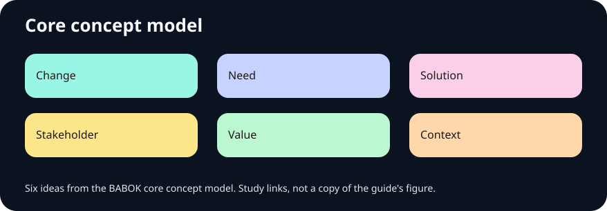

# Business Analyst Free University

A free study lab for business analysis. Open the app, then the rooms. Lucky is a student sharing notes on systems, contact centers, and AI omni-channel work. Omnichannel journeys, contact-center metrics, cloud-migration artifacts, and the ecosystem map are Learn rooms. Nothing here is for sale.

**Fundamentals through credentials, with the source on the note.**

<p>
<a href="index.html"> Open the app</a>
&nbsp;·&nbsp; <a href="https://cyphermonkeylabs.com">Website</a>
&nbsp;·&nbsp; <a href="https://github.com/CypherMonkeyLabs">GitHub</a>
&nbsp;·&nbsp; <a href="https://linktr.ee/cypherMonkey">Profile</a>
</p>

## Run it

```bash
python3 -m http.server 8742
```

Open port 8742 on this computer. `npm run verify` checks local files, the catalog size, brand links, and that the lab has no email link.

Publishing notes, including what is built and what is only prepared, are in `docs/PUBLISHING.md`.

## What is inside

169 notes, 75 diagrams, 36 flows, 54 flashcards. Each room also has a PDF, HTML, DOCX, PPTX, and JSON pack under `downloads/rooms/` (145 files). Every sheet, card, chapter, and room ends with Sources and go deeper. The same list is in `assets/data/sources/` and on the page. Themes, text size, text color, and a guide on the right edge. Contact is the form at https://cyphermonkeylabs.com/#contact.

| Sheet | Path | Kind | Size |
| --- | --- | --- | --- |
| Business requirements outline | `downloads/brd-outline.pdf` | PDF | 6.6 KB |
| Business requirements outline (HTML) | `downloads/html/brd-outline.html` | HTML | 5.0 KB |
| Functional requirements outline | `downloads/frd-outline.pdf` | PDF | 6.5 KB |
| Functional requirements outline (HTML) | `downloads/html/frd-outline.html` | HTML | 4.9 KB |
| Software requirements outline | `downloads/srs-outline.pdf` | PDF | 6.5 KB |
| Software requirements outline (HTML) | `downloads/html/srs-outline.html` | HTML | 4.9 KB |
| User story card | `downloads/user-story-card.pdf` | PDF | 6.5 KB |
| User story card (HTML) | `downloads/html/user-story-card.html` | HTML | 4.9 KB |
| RACI sheet | `downloads/raci-sheet.pdf` | PDF | 6.7 KB |
| RACI sheet (HTML) | `downloads/html/raci-sheet.html` | HTML | 5.1 KB |
| SWOT sheet | `downloads/swot-sheet.pdf` | PDF | 6.7 KB |
| SWOT sheet (HTML) | `downloads/html/swot-sheet.html` | HTML | 5.1 KB |
| Process map checklist | `downloads/process-map-sheet.pdf` | PDF | 6.3 KB |
| Process map checklist (HTML) | `downloads/html/process-map-sheet.html` | HTML | 4.3 KB |
| Certification fee notes | `downloads/cert-fee-notes.pdf` | PDF | 9.4 KB |
| Template workbook | `downloads/ba-templates.docx` | DOCX | 39.0 KB |
| Study deck | `downloads/ba-study-deck.pptx` | PPTX | 41.3 KB |
| HTML sheets, zipped | `downloads/ba-html-sheets.zip` | ZIP | 18.8 KB |
| Core concept model SVG | `downloads/diagrams/baccm.svg` | SVG | 3.4 KB |
| Core concept model HTML | `downloads/diagrams/baccm.html` | HTML | 6.1 KB |
| Six knowledge areas SVG | `downloads/diagrams/areas.svg` | SVG | 3.5 KB |
| Six knowledge areas HTML | `downloads/diagrams/areas.html` | HTML | 6.1 KB |
| Requirement classes SVG | `downloads/diagrams/classes.svg` | SVG | 3.2 KB |
| Requirement classes HTML | `downloads/diagrams/classes.html` | HTML | 5.8 KB |
| Elicitation loop SVG | `downloads/diagrams/elicitation.svg` | SVG | 3.1 KB |
| Elicitation loop HTML | `downloads/diagrams/elicitation.html` | HTML | 5.8 KB |
| Trace chain SVG | `downloads/diagrams/trace.svg` | SVG | 3.1 KB |
| Trace chain HTML | `downloads/diagrams/trace.html` | HTML | 5.8 KB |
| Stakeholder grid SVG | `downloads/diagrams/grid.svg` | SVG | 3.4 KB |
| Stakeholder grid HTML | `downloads/diagrams/grid.html` | HTML | 6.1 KB |
| BPMN pieces SVG | `downloads/diagrams/bpmn.svg` | SVG | 3.1 KB |
| BPMN pieces HTML | `downloads/diagrams/bpmn.html` | HTML | 5.7 KB |
| Story map SVG | `downloads/diagrams/storymap.svg` | SVG | 3.1 KB |
| Story map HTML | `downloads/diagrams/storymap.html` | HTML | 5.8 KB |
| C4 levels SVG | `downloads/diagrams/c4.svg` | SVG | 2.9 KB |
| C4 levels HTML | `downloads/diagrams/c4.html` | HTML | 5.5 KB |
| Small order model SVG | `downloads/diagrams/erd.svg` | SVG | 3.1 KB |
| Small order model HTML | `downloads/diagrams/erd.html` | HTML | 5.8 KB |
| RACI roles SVG | `downloads/diagrams/raci.svg` | SVG | 3.0 KB |
| RACI roles HTML | `downloads/diagrams/raci.html` | HTML | 5.6 KB |
| SWOT quadrants SVG | `downloads/diagrams/swot.svg` | SVG | 3.0 KB |
| SWOT quadrants HTML | `downloads/diagrams/swot.html` | HTML | 5.7 KB |
| HEART categories SVG | `downloads/diagrams/heart.svg` | SVG | 3.3 KB |
| HEART categories HTML | `downloads/diagrams/heart.html` | HTML | 6.0 KB |
| OKR shape SVG | `downloads/diagrams/okr.svg` | SVG | 2.9 KB |
| OKR shape HTML | `downloads/diagrams/okr.html` | HTML | 5.6 KB |
| Discover before converge SVG | `downloads/diagrams/dt.svg` | SVG | 3.0 KB |
| Discover before converge HTML | `downloads/diagrams/dt.html` | HTML | 5.7 KB |
| Job story SVG | `downloads/diagrams/jtbd.svg` | SVG | 3.2 KB |
| Job story HTML | `downloads/diagrams/jtbd.html` | HTML | 5.9 KB |
| ADKAR SVG | `downloads/diagrams/adkar.svg` | SVG | 3.1 KB |
| ADKAR HTML | `downloads/diagrams/adkar.html` | HTML | 5.8 KB |
| Business case parts SVG | `downloads/diagrams/case.svg` | SVG | 3.5 KB |
| Business case parts HTML | `downloads/diagrams/case.html` | HTML | 6.1 KB |
| Matrix columns SVG | `downloads/diagrams/rtm.svg` | SVG | 3.3 KB |
| Matrix columns HTML | `downloads/diagrams/rtm.html` | HTML | 5.9 KB |
| Domain lenses SVG | `downloads/diagrams/domains.svg` | SVG | 3.5 KB |
| Domain lenses HTML | `downloads/diagrams/domains.html` | HTML | 6.2 KB |
| Career evidence SVG | `downloads/diagrams/career.svg` | SVG | 3.2 KB |
| Career evidence HTML | `downloads/diagrams/career.html` | HTML | 5.9 KB |
| Ecosystem map SVG | `downloads/diagrams/ecosystem.svg` | SVG | 3.5 KB |
| Ecosystem map HTML | `downloads/diagrams/ecosystem.html` | HTML | 6.2 KB |
| Scrum events SVG | `downloads/diagrams/sprint.svg` | SVG | 3.1 KB |
| Scrum events HTML | `downloads/diagrams/sprint.html` | HTML | 5.8 KB |
| AI draft loop SVG | `downloads/diagrams/ai.svg` | SVG | 3.1 KB |
| AI draft loop HTML | `downloads/diagrams/ai.html` | HTML | 5.8 KB |
| Verify then validate SVG | `downloads/diagrams/verify-validate.svg` | SVG | 3.2 KB |
| Verify then validate HTML | `downloads/diagrams/verify-validate.html` | HTML | 5.9 KB |
| Priority words SVG | `downloads/diagrams/priority.svg` | SVG | 3.2 KB |
| Priority words HTML | `downloads/diagrams/priority.html` | HTML | 5.9 KB |
| Acceptance shape SVG | `downloads/diagrams/accept.svg` | SVG | 3.0 KB |
| Acceptance shape HTML | `downloads/diagrams/accept.html` | HTML | 5.7 KB |
| Requirement states SVG | `downloads/diagrams/states.svg` | SVG | 3.1 KB |
| Requirement states HTML | `downloads/diagrams/states.html` | HTML | 5.8 KB |
| Workshop roles SVG | `downloads/diagrams/workshop.svg` | SVG | 3.2 KB |
| Workshop roles HTML | `downloads/diagrams/workshop.html` | HTML | 5.8 KB |
| Interview shape SVG | `downloads/diagrams/interview.svg` | SVG | 3.2 KB |
| Interview shape HTML | `downloads/diagrams/interview.html` | HTML | 5.8 KB |
| Observation SVG | `downloads/diagrams/observe.svg` | SVG | 3.3 KB |
| Observation HTML | `downloads/diagrams/observe.html` | HTML | 5.9 KB |
| Rules beside flow SVG | `downloads/diagrams/rules.svg` | SVG | 3.1 KB |
| Rules beside flow HTML | `downloads/diagrams/rules.html` | HTML | 5.7 KB |
| Quality with a number SVG | `downloads/diagrams/nfr.svg` | SVG | 3.0 KB |
| Quality with a number HTML | `downloads/diagrams/nfr.html` | HTML | 5.6 KB |
| Scope box SVG | `downloads/diagrams/scope.svg` | SVG | 2.9 KB |
| Scope box HTML | `downloads/diagrams/scope.html` | HTML | 5.5 KB |
| Options including stop SVG | `downloads/diagrams/options.svg` | SVG | 3.1 KB |
| Options including stop HTML | `downloads/diagrams/options.html` | HTML | 5.8 KB |
| Risk card SVG | `downloads/diagrams/risk.svg` | SVG | 3.1 KB |
| Risk card HTML | `downloads/diagrams/risk.html` | HTML | 5.7 KB |
| Persona card SVG | `downloads/diagrams/persona.svg` | SVG | 3.0 KB |
| Persona card HTML | `downloads/diagrams/persona.html` | HTML | 5.6 KB |
| Journey lanes SVG | `downloads/diagrams/journey.svg` | SVG | 2.9 KB |
| Journey lanes HTML | `downloads/diagrams/journey.html` | HTML | 5.6 KB |
| Context diagram SVG | `downloads/diagrams/context.svg` | SVG | 3.0 KB |
| Context diagram HTML | `downloads/diagrams/context.html` | HTML | 5.7 KB |
| UML sketches SVG | `downloads/diagrams/uml-set.svg` | SVG | 2.9 KB |
| UML sketches HTML | `downloads/diagrams/uml-set.html` | HTML | 5.6 KB |
| Gateway habits SVG | `downloads/diagrams/gateway.svg` | SVG | 3.0 KB |
| Gateway habits HTML | `downloads/diagrams/gateway.html` | HTML | 5.6 KB |
| Two paths SVG | `downloads/diagrams/happy-sad.svg` | SVG | 3.0 KB |
| Two paths HTML | `downloads/diagrams/happy-sad.html` | HTML | 5.6 KB |
| Backlog order SVG | `downloads/diagrams/backlog.svg` | SVG | 3.0 KB |
| Backlog order HTML | `downloads/diagrams/backlog.html` | HTML | 5.7 KB |
| Increment SVG | `downloads/diagrams/increment.svg` | SVG | 3.1 KB |
| Increment HTML | `downloads/diagrams/increment.html` | HTML | 5.7 KB |
| Three accountabilities SVG | `downloads/diagrams/roles-scrum.svg` | SVG | 3.0 KB |
| Three accountabilities HTML | `downloads/diagrams/roles-scrum.html` | HTML | 5.7 KB |
| Board with a limit SVG | `downloads/diagrams/kanban-board.svg` | SVG | 2.9 KB |
| Board with a limit HTML | `downloads/diagrams/kanban-board.html` | HTML | 5.6 KB |
| Design sprint days SVG | `downloads/diagrams/sprint-kit.svg` | SVG | 3.2 KB |
| Design sprint days HTML | `downloads/diagrams/sprint-kit.html` | HTML | 5.9 KB |
| Switch forces SVG | `downloads/diagrams/forces.svg` | SVG | 3.0 KB |
| Switch forces HTML | `downloads/diagrams/forces.html` | HTML | 5.7 KB |
| Learn then choose SVG | `downloads/diagrams/double-diamond.svg` | SVG | 3.0 KB |
| Learn then choose HTML | `downloads/diagrams/double-diamond.html` | HTML | 5.7 KB |
| KPI card SVG | `downloads/diagrams/kpi-card.svg` | SVG | 3.2 KB |
| KPI card HTML | `downloads/diagrams/kpi-card.html` | HTML | 5.9 KB |
| One SQL question SVG | `downloads/diagrams/sql-path.svg` | SVG | 3.0 KB |
| One SQL question HTML | `downloads/diagrams/sql-path.html` | HTML | 5.7 KB |
| Event log fields SVG | `downloads/diagrams/event-log.svg` | SVG | 3.0 KB |
| Event log fields HTML | `downloads/diagrams/event-log.html` | HTML | 5.7 KB |
| Ticket hygiene SVG | `downloads/diagrams/jira-flow.svg` | SVG | 3.0 KB |
| Ticket hygiene HTML | `downloads/diagrams/jira-flow.html` | HTML | 5.7 KB |
| Decision page SVG | `downloads/diagrams/conf-page.svg` | SVG | 3.0 KB |
| Decision page HTML | `downloads/diagrams/conf-page.html` | HTML | 5.6 KB |
| Draft checklist SVG | `downloads/diagrams/ai-check.svg` | SVG | 2.9 KB |
| Draft checklist HTML | `downloads/diagrams/ai-check.html` | HTML | 5.6 KB |
| Prompt parts SVG | `downloads/diagrams/prompt.svg` | SVG | 2.9 KB |
| Prompt parts HTML | `downloads/diagrams/prompt.html` | HTML | 5.6 KB |
| Human handoff SVG | `downloads/diagrams/handoff.svg` | SVG | 3.2 KB |
| Human handoff HTML | `downloads/diagrams/handoff.html` | HTML | 5.8 KB |
| Healthcare lens SVG | `downloads/diagrams/fhir-lens.svg` | SVG | 3.1 KB |
| Healthcare lens HTML | `downloads/diagrams/fhir-lens.html` | HTML | 5.8 KB |
| Accessibility checks SVG | `downloads/diagrams/a11y.svg` | SVG | 3.0 KB |
| Accessibility checks HTML | `downloads/diagrams/a11y.html` | HTML | 5.7 KB |
| Same questions SVG | `downloads/diagrams/vendor.svg` | SVG | 3.1 KB |
| Same questions HTML | `downloads/diagrams/vendor.html` | HTML | 5.8 KB |
| Change record SVG | `downloads/diagrams/change-ctrl.svg` | SVG | 2.9 KB |
| Change record HTML | `downloads/diagrams/change-ctrl.html` | HTML | 5.6 KB |
| Release note SVG | `downloads/diagrams/release.svg` | SVG | 3.0 KB |
| Release note HTML | `downloads/diagrams/release.html` | HTML | 5.6 KB |
| Retro prompts SVG | `downloads/diagrams/retro.svg` | SVG | 2.9 KB |
| Retro prompts HTML | `downloads/diagrams/retro.html` | HTML | 5.6 KB |
| STAR card SVG | `downloads/diagrams/star.svg` | SVG | 3.0 KB |
| STAR card HTML | `downloads/diagrams/star.html` | HTML | 5.7 KB |
| Journey map elements SVG | `downloads/diagrams/omni-parts.svg` | SVG | 3.4 KB |
| Journey map elements HTML | `downloads/diagrams/omni-parts.html` | HTML | 6.1 KB |
| Channels named on the overview SVG | `downloads/diagrams/omni-channels.svg` | SVG | 3.4 KB |
| Channels named on the overview HTML | `downloads/diagrams/omni-channels.html` | HTML | 6.1 KB |
| Journey then blueprint SVG | `downloads/diagrams/omni-blueprint.svg` | SVG | 3.3 KB |
| Journey then blueprint HTML | `downloads/diagrams/omni-blueprint.html` | HTML | 6.1 KB |
| What this AHT adds SVG | `downloads/diagrams/aht-parts.svg` | SVG | 3.4 KB |
| What this AHT adds HTML | `downloads/diagrams/aht-parts.html` | HTML | 6.0 KB |
| Removed from queue inside X SVG | `downloads/diagrams/sl-split.svg` | SVG | 3.4 KB |
| Removed from queue inside X HTML | `downloads/diagrams/sl-split.html` | HTML | 6.1 KB |
| Before you publish a KPI SVG | `downloads/diagrams/metric-owner.svg` | SVG | 3.3 KB |
| Before you publish a KPI HTML | `downloads/diagrams/metric-owner.html` | HTML | 6.1 KB |
| Three migration workstreams SVG | `downloads/diagrams/migrate-streams.svg` | SVG | 3.5 KB |
| Three migration workstreams HTML | `downloads/diagrams/migrate-streams.html` | HTML | 6.2 KB |
| Analysis pack for the move SVG | `downloads/diagrams/migrate-pack.svg` | SVG | 3.6 KB |
| Analysis pack for the move HTML | `downloads/diagrams/migrate-pack.html` | HTML | 6.3 KB |
| Contact-center mind map SVG | `downloads/diagrams/eco-mind.svg` | SVG | 3.6 KB |
| Contact-center mind map HTML | `downloads/diagrams/eco-mind.html` | HTML | 6.3 KB |
| Sister technologies on the overview SVG | `downloads/diagrams/eco-sisters.svg` | SVG | 3.5 KB |
| Sister technologies on the overview HTML | `downloads/diagrams/eco-sisters.html` | HTML | 6.2 KB |
| Integration sequence SVG | `downloads/diagrams/eco-integrate.svg` | SVG | 3.4 KB |
| Integration sequence HTML | `downloads/diagrams/eco-integrate.html` | HTML | 6.1 KB |
| Flashcards | `downloads/flashcards.json` | JSON | 239.3 KB |
| Flashcards HTML | `downloads/html/flashcards.html` | HTML | 9.7 KB |
| Flashcards PDF | `downloads/flashcards.pdf` | PDF | 14.1 KB |
| Cheat sheet HTML | `downloads/html/cheat-sheet.html` | HTML | 4.2 KB |
| Cheat sheet PDF | `downloads/cheat-sheet.pdf` | PDF | 6.2 KB |

## Disclaimer

Independent, free, learning-only student project. Respects every company and vendor. Trademarks belong to their owners. Not affiliated or endorsed. Names in the contact-center rooms are citations of pages opened in October 2026, not endorsements. Concerns are removed or corrected promptly via the contact form at https://cyphermonkeylabs.com/#contact. Nothing is sold. Happy to volunteer for any organization.

**CypherMonkey Labs**

© 2026 CypherMonkeyLabs 🐒

[Website](https://cyphermonkeylabs.com) · [GitHub](https://github.com/CypherMonkeyLabs) · [Profile](https://linktr.ee/cypherMonkey)
